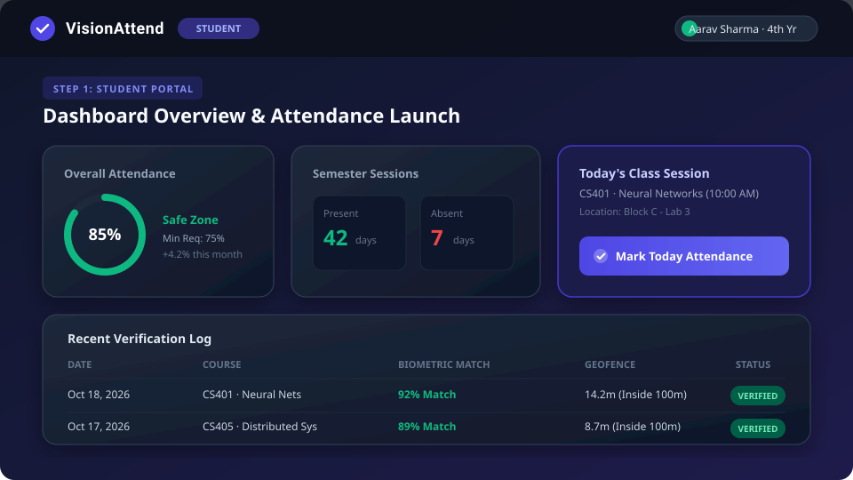
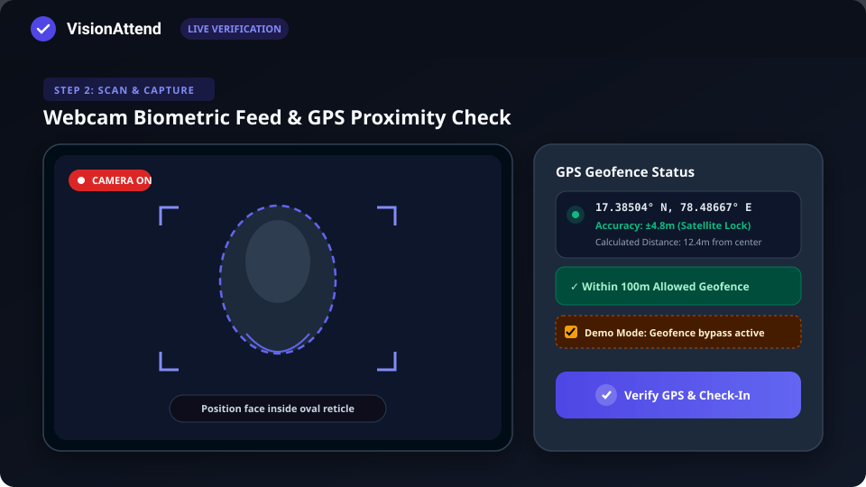
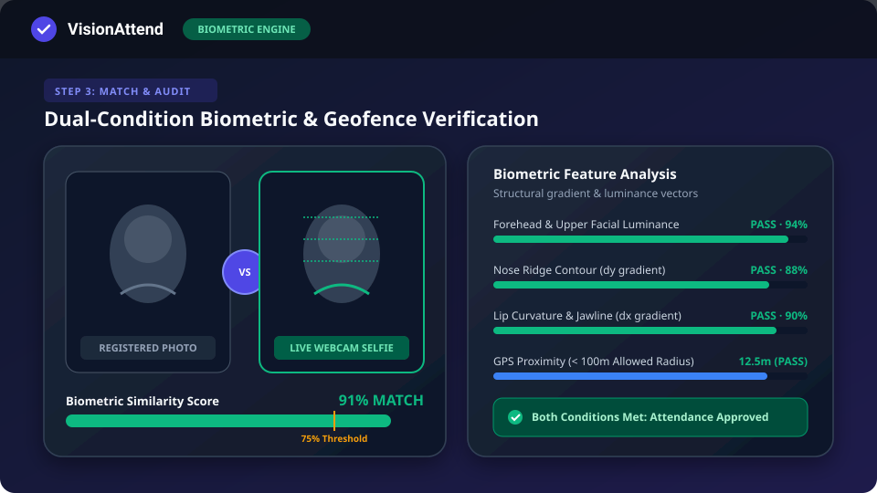
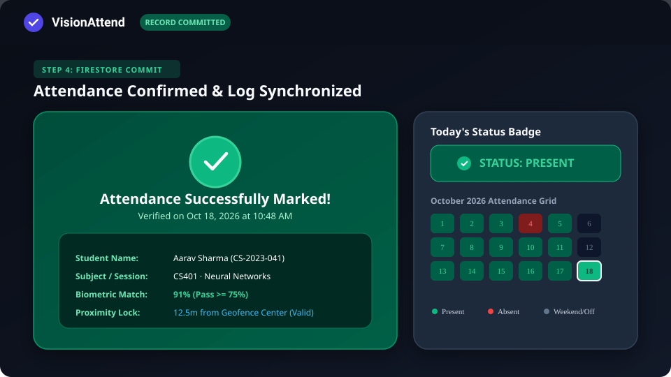
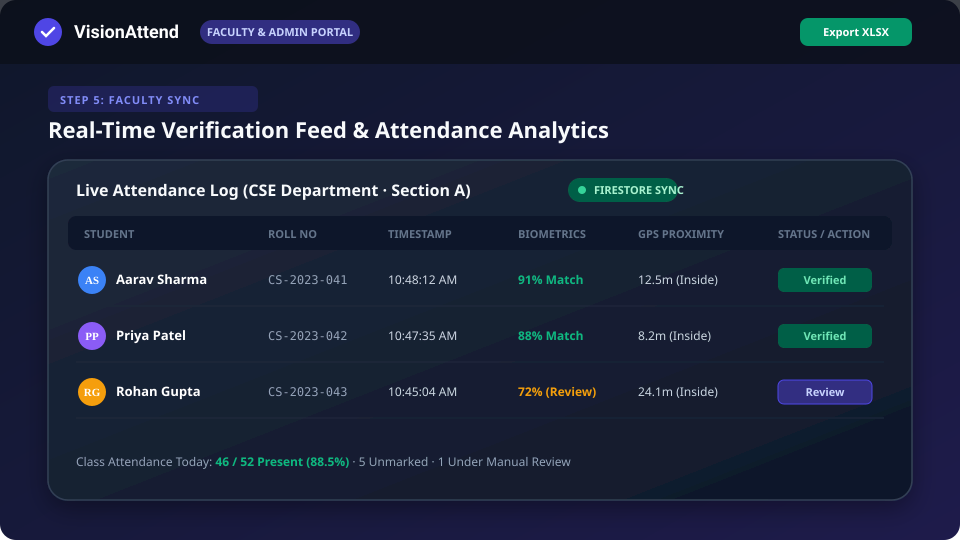

# VisionAttend

A college attendance system built to eliminate buddy-punching and location spoofing using client-side biometric facial comparison and GPS geofencing.

---

## The Problem It Solves

Most college attendance apps suffer from two common exploits:
1. **Proxy Attendance / Buddy Punching**: Students share logins or send screenshots of QR codes to friends in class.
2. **Fake GPS / Indoor Spoofing**: Students mark attendance from dorm rooms or cafes using location-spoofing browser extensions or cached indoor coordinates.

**VisionAttend** requires students to satisfy two independent physical checks at the exact moment of check-in:
- **Biometric Face Match**: Compares a live webcam selfie against registered reference templates on record (structural gradients + luminance correlation >= 75%).
- **Campus GPS Geofence Lock**: Verifies the student's physical device coordinates fall within 100 meters of the designated campus center point using the Haversine formula, while rejecting low-precision indoor or simulated signals.

---

## Step-by-Step Workflow

### Step 1: Student Dashboard & Session Launch
The student logs in, views their current semester standing, overall attendance percentage, and finds today's scheduled lecture session.



- **Student Actions**: Select their profile, check attendance thresholds (alert triggers if below the 75% minimum university requirement), and click **"Mark Today Attendance"**.
- **System Actions**: Queries the current schedule and loads the student's registered biometric reference templates from Cloud Firestore.

---

### Step 2: Camera Viewfinder & Real-Time GPS Triangulation
The camera modal opens with a live video stream and initiates satellite location lock via the browser Geolocation API.



- **Facial Framing**: An oval targeting reticle helps the student frame their face evenly under ambient light.
- **GPS Telemetry**: Lat/long coordinates and accuracy radii are calculated in real time. If an indoor or low-accuracy mock coordinate is detected, the submission button is disabled.
- **Demo Mode Switch**: For remote demonstrations or environments without clear satellite reception, the **"Demo Mode: Bypass GPS Geofence"** checkbox simulates an authorized 12.5-meter distance to allow biometric testing.

---

### Step 3: Biometric Feature Matching & Geofence Verification
When the student captures their selfie, the client-side computer vision pipeline extracts facial contours and checks proximity.



- **Biometric Processing**:
  - Image is normalized and downsampled to standardized dimensions.
  - Directional Sobel gradients ($\partial x, \partial y$) are computed across key regions (forehead luminance, nasal ridge curvature, lip boundary).
  - Pearson correlation coefficients are combined into a weighted similarity score (threshold: 75%).
- **Geofence Check**:
  - Distance to campus center coordinates is computed via the Haversine formula:
    $$d = 2R \cdot \arcsin\left(\sqrt{\sin^2\left(\frac{\Delta\phi}{2}\right) + \cos(\phi_1)\cos(\phi_2)\sin^2\left(\frac{\Delta\lambda}{2}\right)}\right)$$
  - Must be $\le 100\text{ meters}$.

---

### Step 4: Real-Time Record Commitment & Calendar Update
Once both criteria pass, the system commits the attendance record to Firestore and updates the student's local view immediately.



- **Confirmation Card**: Displays verification confidence, calculated distance from center, timestamp, and a breakdown of facial component scores.
- **Calendar Synchronization**: Today's calendar cell switches to green (`PRESENT`). Semester metrics and attendance graphs recalibrate on the fly.

---

### Step 5: Faculty Live Feed & Administrative Oversight
Faculty members monitor submissions in real time as students check in at the start of class.



- **Live Stream**: Records populate dynamically without page refreshes via Firestore snapshot listeners.
- **Audit & Review**: Faculty can inspect submitted selfies, review GPS coordinates on a map, and trigger a manual override if a student encounters hardware issues.
- **Exporting**: One-click download of attendance sheets to `.xlsx` (Excel) formatted for university registrar reporting.

---

## Technical Specifications

### Biometric Engine Parameters
| Parameter | Threshold | Description |
| :--- | :--- | :--- |
| Composite Similarity | $\ge 75\%$ | Weighted combination of structural gradient and luminance vectors |
| Upper Luminance ($r_{\text{lum}}$) | $\ge 0.50$ | Forehead and ambient skin tone distribution match |
| Horizontal Gradients ($r_{\text{dx}}$) | $\ge 0.10$ | Lip corners, cheek contours, and jaw symmetry |
| Vertical Gradients ($r_{\text{dy}}$) | $\ge 0.10$ | Nasal bridge profile and brow curvature |
| Geofence Radius | $\le 100\text{ m}$ | Maximum allowable distance from campus coordinates |

### Tech Stack
- **Client**: React 19, TypeScript, Tailwind CSS, Lucide Icons, Motion
- **Server**: Express 4, Node.js (`server.ts` running Vite middleware in dev)
- **Database**: Google Cloud Firestore (collections: `students`, `attendance`, `courses`, `departments`)
- **Data Export**: SheetJS (`xlsx`)

---

## Local Development Setup

### 1. Install dependencies
```bash
npm install
```

### 2. Configure environment
```bash
cp .env.example .env
```
Ensure your Firebase configuration keys and Google Gemini API credentials are set in `.env` if using cloud-hosted database instances.

### 3. Start development server
```bash
npm run dev
```
Open `http://localhost:3000` in your browser. Grant browser permissions for **Camera** and **Location** when prompted.

### 4. Build for production
```bash
npm run build
npm run start
```

---

## Project Structure

```
├── assets/                          # SVG workflow diagrams and visual assets
│   ├── workflow-step1-portal.svg
│   ├── workflow-step2-camera.svg
│   ├── workflow-step3-biometrics.svg
│   ├── workflow-step4-confirmation.svg
│   └── workflow-step5-faculty.svg
├── src/
│   ├── components/
│   │   ├── CameraView.tsx           # Webcam stream, reticle, GPS tagger
│   │   ├── StudentDashboard.tsx     # Student self-service, check-in, calendar
│   │   ├── FacultyDashboard.tsx     # Real-time monitoring table and approvals
│   │   ├── AdminDashboard.tsx       # Geofence settings and department stats
│   │   └── Navbar.tsx               # Role switcher and status indicators
│   ├── utils/
│   │   ├── imageCompressor.ts       # Sobel gradient and luminance correlation
│   │   └── geofence.ts              # Haversine distance calculator
│   ├── firebase.ts                  # Firestore SDK client initialization
│   ├── types.ts                     # Data models for students, attendance, logs
│   ├── App.tsx                      # Root component and navigation state
│   └── main.tsx                     # React 19 mount point
├── firestore.rules                  # Security rules for student/faculty roles
├── server.ts                        # Express backend proxy
└── vite.config.ts                   # Bundler configuration
```

---

## Testing & Verification Notes

- **Testing with Webcam**: In test environments or when verifying with different lighting conditions, ensure your face is well-lit and centered within the camera reticle.
- **Testing without Campus GPS**: Check the **"Demo Mode: Bypass GPS Geofence"** toggle at the top of the verification dialog. This allows you to test the facial recognition pipeline anywhere while fixing simulated coordinates inside the 100m radius.
